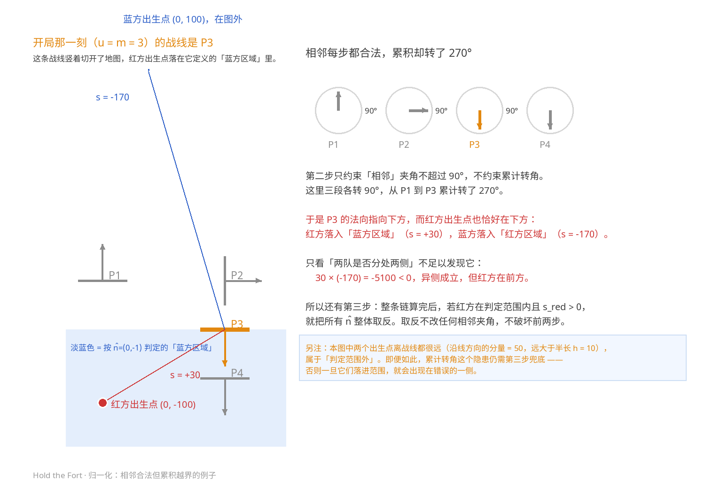

# 战线模式（Hold the Fort）· 游戏设计文档

| 项目 | 内容 |
|---|---|
| 版本 | 1.0-draft |
| 日期 | 2026-10-29 |
| 平台 | Minecraft Java Edition · Paper 服务端插件 |
| 状态 | 机制已形式化；v1 范围内无未决项（§9.2） |

> 本文档是**唯一事实来源**：项目内部的规则都以它为准，不依赖任何外部设计稿。
> 假设读者具备 Minecraft / Paper 的基本常识（坐标系、yaw、实体、粒子等）。
> 已拍板的设计决策见 §9.1，未决问题见 §9.2。

---

## 速览（30 秒版）

- **核心**：一条战线把战场分成两半。谁在**对方区域**里的人数多，战线就往对方基地移动；推到端点即胜。
- **检查点对 = 关键帧**：两点连成的**线段**就是该编号的战线；线段以外是「判定范围外」。
  这让 U 形 / S 形地图成为可能 —— 战线只需覆盖要判定的那一段。
- **插件只在数据写错时拒绝加载**；其余（地图形状、开局是否平衡、战线盖没盖住战场）全由设计者决定，插件只给提示。
- **设计者填三样**：关键帧坐标、编号、**两队出生点**。战线位置/朝向由插件算，`p、q` 顺序无语义；
  **哪边是红方由「红方出生点」决定**（出生点必须在自己区域，这条要求反过来说就是定义）。
- **编号增大 = 红方推进**，所以红方基地在 $n=1$ 那一端、蓝方基地在 $n=N$ 那一端。
- **插值**：位置线性 + 朝向最短弧。默认单段转向 $\le 90^\circ$（防止区域对调），可用 `turn_limit: free` 解锁。
- **反复横跳是允许的**：战线前进再后退（见 §6.2 的例子）完全合法。
- **转向怎么办**：系统**自动归一化**每个关键帧的朝向，保证相邻夹角 $\le 90^\circ$、区域不在关键帧处突变。
  所以「先前进、再后退」的地图是**合法**的：表现为朝向不变、由前进转后退。
- **进度**：$\dfrac{\mathrm du}{\mathrm dt}=\dfrac{V(t)}{w(u)}f$；$V$ 是**物理速度**（格/秒），$w(u)$ 是当前段的路程权重（格），$f\in[-1,1]$ 是态势因子（v1 取 $\operatorname{sgn}(r-b)$）。$V$ 随时间递增，15 分钟兜底结算。
- **颜色**：u 涨 = 红，u 跌 = 蓝，停滞 = 中性。
- **v1 不做**：装备/经济/商店、多地图轮换、持久化统计。

> 只想快速过一遍的话，看 **§2.5（建图规则）** 和 **§9（决策与待定项）** 就够。

---

## 0. 一句话概括

两队（红 / 蓝）在一条**战线**两侧对抗。玩家越过战线进入**敌方区域**后，战线会按「双方在敌方区域的人数差」朝对方基地移动；战线推到任一方基地即分出胜负。

---

## 1. 术语表

| 术语 | 记号 | 定义 |
|---|---|---|
| 检查点 | $\mathbf P=(x,z)$ | 战场上的一个水平坐标点，无 $y$ 分量 |
| 检查点对 | $C_n=(n,\mathbf p_n,\mathbf q_n)$ | 编号 $n\in\{1,\dots,N\}$，由两个检查点构成 |
| 关键帧 | — | 「检查点对」的别名，强调它只是插值用的关键帧（§2.1） |
| 战线（逻辑） | 线段 $\mathbf E(u)\pm h(u)\hat{\mathbf d}(u)$ | 由进度 $u$ 决定的**水平线段**；线段内分敌我，线段外是判定范围外 |
| 战线实体 | $\mathbf E$ | 战场中的一个不可见实体，仅用于提供战线的位置与朝向 |
| 朝向 | $\hat{\mathbf n}$ | 单位水平向量，指向**蓝方区域**一侧，$\hat n_y=0$ |
| 前方 / 后方 | — | 沿 $\hat{\mathbf n}$ 为正的一侧为**前方 = 蓝方区域**；反之为**后方 = 红方区域** |
| 游戏进度 | $u$ | 实数，单位 =「检查点对序号」；$u$ 增大表示红方推进（§2.3、§5.3） |
| 入侵者 | — | 位于敌方区域内的玩家 |

---

## 2. 战场与战线关键帧（检查点对）

### 2.1 几何关系

检查点对是**战线的关键帧（keyframe）**。设计者对它只提供一个东西：**两个坐标**。
位置、朝向、以及「必要时要不要翻转」，全部由插件计算，设计者既不需要也无法指定。

对第 $n$ 号关键帧 $(\mathbf p_n,\mathbf q_n)$，插件算出：

$$
\begin{aligned}
\mathbf d_n &= \operatorname{normalize}(\mathbf q_n-\mathbf p_n) && \text{两点连线的水平方向}\\
\mathbf m_n &= \tfrac12\left(\mathbf p_n+\mathbf q_n\right) && \text{中点}\\
h_n &= \tfrac12\left\lVert \mathbf q_n-\mathbf p_n\right\rVert && \text{战线半长（向两侧各延伸这么多）}\\
\mathbf m_0 &= \mathbf{spawn}_{\text{red}} && \text{虚拟第 0 个中点 = 红方出生点}\\
\mathbf v_n &= \mathbf m_n-\mathbf m_{n-1} && \text{战线从上一帧走过来的方向}\\
\hat{\mathbf n}^{\,0}_n &= \operatorname{normalize}\!\left(\mathbf v_n-(\mathbf v_n\cdot\mathbf d_n)\,\mathbf d_n\right) && \text{候选 A：}v_n\text{ 垂直于 }d_n\text{ 的分量}\\
\hat{\mathbf n}^{\,1}_n &= -\hat{\mathbf n}^{\,0}_n && \text{翻转后的朝向（候选 B）}\\
\theta_n &= \operatorname{atan2}\!\left(-\hat n_x,\;\hat n_z\right) && \text{对应的 Minecraft yaw（角度制）}
\end{aligned}
$$

Minecraft 的 yaw 约定：水平朝向 $\hat{\mathbf n}=(\hat n_x,0,\hat n_z)$ 对应的 yaw 为
$\theta=\operatorname{atan2}(-\hat n_x,\hat n_z)$（单位：**度**），
即 $\theta=0$ 朝 $+z$、$\theta=90^\circ$ 朝 $-x$，**yaw 递增 = 从上往下看顺时针**。
后文凡涉及旋转的公式，$\theta$ 一律用度；只有 §5.6 的路程权重需要弧度，那里会显式换算。

于是：

- **位置**固定是中点 $\mathbf m_n$（没有选择余地，也不需要选择）；
- **朝向**只有两个候选，互为反向 —— 也就是同一条直线、两种贴标签方式。
  最终用哪一个，由 §6.2 的归一化决定。

**结论**：第 $n$ 号状态下的战线，就是**以 $\mathbf p_n$、$\mathbf q_n$ 为两端的线段**；
实体站在中点，朝向垂直于这条线段。

由此得到三条重要推论：

1. **检查点不需要 y 坐标**。它们只参与 (x, z) 平面上的直线计算，与地形完全无关
   —— 这也是地图可以有任意起伏、任意建筑的原因。
2. **两个检查点既是方向支点，也是战线的两端**。线段以外的玩家处于「判定范围外」（§5.1），
   不参与推进 —— 这正是非凸地图（U 形、S 形）能被支持的关键：战线不必横贯整张图，
   只覆盖需要判定的那一段。把两点放得很远，就等于「整条线都算」，是常见选择。
3. **整个计算对 `p ↔ q` 对称**：交换任意一帧的两个检查点，$\mathbf d$ 反号、$\mathbf m$ 不变，
   而候选 A 的公式对 $\mathbf d\to-\mathbf d$ 不变（见上式），所以**候选集合与最终结果完全相同**。
   所以「p、q 谁写在前面」没有任何语义，写反了也不会影响任何东西。

> 推导：「战线过实体且垂直于朝向」（§3）+「实体在两点中点」（上表）两条合起来，
> 唯一自洽的解就是「战线 = 以两点为端的线段，实体在其中点」。
> 用 §6.2 的反复横跳例子验证：$P_1(z=0)\to P_2(z=1)$ 平行前移、朝向不变；
> $P_2(z=1)\to P_3(z=-1)$ 向 $-z$ 平移、朝向同样不变。

### 2.2 设计者决定什么、插件决定什么

| | 由**设计者**决定 | 由**插件**决定 |
|---|---|---|
| 坐标 | 每对检查点的两个 `(x, z)` | — |
| 顺序 | 关键帧的**编号顺序** `1..N` | — |
| 形态 | — | 战线在 $u=n$ 时的位置（中点）与朝向 |
| 朝向 | — | 翻转前的候选 $\hat{\mathbf n}^{\,0}$、翻转后的候选 $\hat{\mathbf n}^{\,1}$、以及最终选哪个 |
| 敌我 | **决定哪边是红方**：由红方出生点决定 | 由此推出整条链的朝向符号（§6.2 第三步） |

> 一句话：**设计者填「坐标 + 编号 + 出生点」，其余全部是插件的事。**

于是有四个「该改什么」的对照：

| 你想控制 | 该改 | 不该改（改了也没用） |
|---|---|---|
| 战线在哪 | 检查点坐标 | — |
| 红方从哪一端推进 | **编号顺序**（§2.3） | 点的书写顺序 |
| 哪边是红方 | **红方出生点** | 点的书写顺序 |
| 战线朝向 | 不用管 | 想管也管不了 |

### 2.3 编号方向 = 红方推进方向

推进方向就是编号方向：$u$ 增大 → 战线向编号增大的方向移动（§6）；而 $u$ 增大至 $U$ 时红方胜（§5.3）。
因此必然是：

> **红方基地在 $n=1$ 的一端，蓝方基地在 $n=N$ 的一端。**
> 两队出生点的摆放必须遵守这一约定，否则开局即出现「出生在敌方区域」。
>
> ⚠️ 编号写反了会怎样：不会有任何报错，但战线会朝着**红方自己的基地**推进。
> 插件不检查这一点 —— 发现方向反了，把 `checkpoints` 的顺序倒过来即可。

### 2.4 校验分级

地图加载时只有两档：**L 会阻止开局，W 只是提示**。
判断标准只有一条 —— **数据本身是否说得通**。建图好不好玩、平不平衡，不属于插件的职责。

#### L 级 · 数据完整性（数据本身说不通，程序无法运行）

| | 规则 |
|---|---|
| L1 | 关键帧编号从 $1$ 连续到 $N$，且 $N$ 等于 `checkpoints` 的列表长度 |
| L2 | $\mathbf p_n\ne\mathbf q_n$（退化为点时朝向无定义） |
| L3 | 相邻两帧不得完全相同：不允许同时满足 $\mathbf m_n=\mathbf m_{n-1}$ 且 $\theta_n=\theta_{n-1}$（否则路程权重为 0） |
| L4 | $N\ge 3$（至少三帧，才存在合法的起始进度 $m$） |

#### W 级 · 警告（能自动修就自动修，修不了只提示）

| | 检查 | 处理 |
|---|---|---|
| W1 | $L<m<U$ 不成立 | **自动** clamp 到合法区间并警告 |
| W2 | 某一段的路程权重**大于**全程的 $1/4$ | 提示：该段会占用明显更长的对局时间（视觉速度已由 §5.6 归一化，只是耗时更长） |
| W3 | 某帧 $\lVert\mathbf q_n-\mathbf p_n\rVert<16$ 格 | 提示：战线会很短，判定范围随之很小；太短时方向也容易被坐标误差带偏 |
| W4 | 开局时两个出生点**都**在判定范围外 | 提示：对局会从「接近阶段」开始 —— 谁先走进范围，谁才能推线 |
| W5 | 开局时两队出生点都在判定范围内、且位于同一侧 | 提示：**开局就不平衡** —— 落在一方区域里的那队会立刻被算成入侵者，开局即推进 |

### 2.5 建图规范（给地图制作者）

**插件只在你把数据写错时拒绝加载**

字段缺失、编号不连续、两个检查点重合、相邻两帧完全相同 —— 这些会拒绝加载（§2.4 的 L 级）。
除此之外什么都不拦：检查点放哪、地图什么形状、战线中途怎么绕、开局是不是势均力敌，全由你决定。

> 有几件事插件**不会**替你兜底，但会在加载日志里提示（W 级）：
> 开局两队同侧（那队会立刻被算成入侵者）、开局都没人处于判定范围、某段特别长、战线特别短。

**整条链只旋转、不移动的地图同样合法**

例如圆形战场：检查点对放在圆外、连线穿过圆心，随着编号增加让这条直径缓缓转动。
此时所有中点重合（$\mathbf m_n$ 全都相同），战线**只转不移**，
$u$ 推进时战线会绕圆心扫一圈，双方区域也随之转动。

- 这种地图在 §6.2 里走的是「候选 A 无定义」的退化分支：每帧取与上一帧夹角不超过 $90^\circ$ 的那个候选。
- 每段的代价完全来自旋转项（§5.6），所以照样有明确的推进速度。
- 累积转过 $180^\circ$ 之后双方区域会对调 —— **允许**，但需要地图设计者自己对节奏负责。

**「反复横跳」是允许且预期的玩法**

以中点为 $(0,0)\to(0,1)\to(0,-1)$ 的三个关键帧为例：战线先前进一格，再大幅后退 —— 合法，而且好玩。
这类地图不需要任何特殊处理：`turn_limit: 90` 会对**单段超过 $90^\circ$** 的转向自动归一化，
但对来回移动完全无感 —— 后退段会被换回候选 B，区域不换边。

**建议（影响体验，不影响合法性）**

1. 相邻关键帧的间距**不影响视觉速度**（§5.6 归一化），但过长的段会让对局在该段停留更久，
   建议单段不超过全程的 $1/4$（恰好等于不触发警告）。
2. 关键帧两端尽量关于战线中点对称 —— 插值路径更「干净」，横向漂移更少。
3. 首尾关键帧别贴着自己基地 —— 太近的话终局阶段战线会压在出生点上。
4. 想玩「区域对调」，就在地图里声明 `turn_limit: free`（见 §6.3）。
5. **多层地形随便用**：地下通道、塔楼、桥面都照常参与判定（按 $(x,z)$ 竖直柱），
   怎么利用是地图设计的一部分，插件不做限制（§3）。

> **p、q 写反了会怎样？** 什么都不会发生 —— 整个计算对 `p ↔ q` 对称（§2.1 推论 3），
> 写反只会让两个候选朝向互换，归一化后的结果完全一致。

---

## 3. 战线实体

| 属性 | 规定 |
|---|---|
| 实体类型 | Minecraft `marker`（不可见、无碰撞、不被攻击、不参与任何物理） |
| 位置 | $\mathbf E(u)=(m_x,\,y,\,m_z)$ —— 水平坐标取自 §6 的插值结果，$y$ **不参与任何逻辑计算** |
| 朝向 | `pitch = 0` **恒成立**；`yaw = θ(u)`（由 §2.2、§6.2 计算得出，不由设计者指定） |
| 可见性 | 实体本身永不可见，玩家只看到粒子形成的战线 |
| 生命周期 | 仅在对局进行中存在；结算后移除 |

> 检查点不带 $y$ 坐标（§2.1），此处明确其后果：
> **区域判定是对 (x, z) 平面的划分，地形在垂直方向上的高度完全不参与判定**
> （即一个竖直的「领土柱」）。若地图存在多层结构（地下通道、塔楼、桥面），
> 站在上层与下层会被判为同一区域。
>
> **这是有意的简化，不是缺陷**：多层地形如何利用（绕后路线、立体攻防）交给地图设计者权衡，
> 插件既不禁止也不特殊处理。

---

## 4. 战线的渲染

### 4.1 粒子落在哪（硬性规则）

沿战线这条线段，逐个 $(x,z)$ 列扫描（只扫线段覆盖的列），对每一列执行：

> **找出所有「自身非空气、且正上方一格是空气」的方块，在它们的顶面各生成一份粒子。**

即同时满足 `(x,y,z)` 非空气 且 `(x,y+1,z)` 是空气 → 在 `y+1` 处放粒子。

- **同一列可能有多个 $y$ 符合条件**（桥面、树冠、塔楼、悬空平台、洞穴顶……），
  **全部都要显示**，不取最高点、不做取舍。
- 这样战线会自动贴合所有可站立表面，玩家站在任何一层都能看到线从脚下穿过。
- 判定只看**方块是不是空气**，不看碰撞箱、不看能否站立 —— 树叶、玻璃、栅栏上方同样有粒子。

渲染只覆盖战线线段本身（中心 $\mathbf E(u)$、半长 $h(u)$），见 §4.4。

### 4.2 战线颜色（硬性规则）

颜色表达的是**趋势**，不是归属：只有 $u$ 在涨的时候才是红色。

| $u$ 的变化 | 粒子颜色 |
|---|---|
| $\dfrac{\mathrm du}{\mathrm dt}>0$（红方推进） | 红色系 |
| $\dfrac{\mathrm du}{\mathrm dt}<0$（蓝方推进） | 蓝色系 |
| $\dfrac{\mathrm du}{\mathrm dt}=0$（停滞） | 中性色（白 / 淡灰） |

- 与 §5.3 的 $\operatorname{sgn}(r-b)$ 直接绑定：谁的净优势为正，战线就是谁的颜色。
- **抖动抑制**：趋势翻转后颜色做 0.3~0.5 秒的平滑过渡，避免玩家站在线上时颜色闪个不停。

### 4.3 跨线提示（v1 必做）

| 增强 | 作用 |
|---|---|
| 越过战线的即时反馈 | 玩家跨线瞬间在 actionbar 提示「已进入敌方区域」，避免「我到底算不算入侵」的困惑 |

### 4.4 性能约束

粒子必须**按玩家分别发送**（`player.spawnParticle`），且只对「在战线附近一定距离内」的玩家发送，
避免全服广播。

§4.1 的多层规则会让一列产出多个粒子点，因此需要两个上限：

- **横向步长**：沿线段的采样间隔，默认 $1$ 格（可调 $0.5\sim2$）；
- **横向范围**：就是战线线段本身 —— 中心 $\mathbf E(u)$、半长 $h(u)$（§5.1）。不再有额外的配置项。

两者相乘即单帧横向粒子上限；列内多层的数量由地形决定，通常远小于横向数量。

**其余必须定死的参数**

| 参数 | 默认 | 说明 |
|---|---|---|
| 垂直扫描范围 | 世界最低到最高的**已加载区块** | 逐列取该列所有满足 §4.1 的 $y$；列所在区块未加载则**跳过该列**（不强行加载） |
| 刷新频率 | 每 2 tick 重算一次 | 采样点的位置随 $u$ 平滑变化，无需每 tick 全量重算；粒子本身每个 tick 补发 |
| 距离分档 | $<32$ 用步长 1、$32\sim64$ 用 2、$>64$ 用 4 | 离战线中点超过 $256$ 格的玩家**不发送** |
| 粒子可见度 | `ALL`=1.0、`DECREASED`=0.5、`MINIMAL`=0.25 | 乘在单帧粒子数上的密度倍率（`ClientOption.PARTICLE_VISIBILITY`） |

### 4.5 客户端与网络成本（重要）

**粒子是客户端渲染的，但服务端并不是零成本**：

- 每个粒子都要序列化进网络包。用 `player.spawnParticle` 是**按玩家**发，成本 ≈ 玩家数 × 粒子数；
  用 `world.spawnParticle` 会广播给所有人 —— **禁止使用**。
- 真正的瓶颈在**客户端 FPS**：粒子是常见的掉帧来源，尤其当战线横跨整张图时。

因此本插件的策略是：

- **不依赖任何客户端模组**（包括 Sodium）。本插件的卖点是「零安装」，
  把性能寄托在玩家装 mod 上等于自断卖点；而且 Sodium 主要优化区块渲染，对粒子的帮助有限。
- **按距离分级**：离得越远，横向步长越大、粒子越稀（§4.4）。
- **尊重玩家自己的视频设置**：Paper 提供 `ClientOption.PARTICLE_VISIBILITY`
  （`ALL` / `DECREASED` / `MINIMAL`），按档位下调密度 —— 这是最「不打扰玩家」的做法。
- **不做遮挡剔除**：判断某段战线是否被建筑挡住需要射线检测，服务端成本远高于省下的粒子。

---

## 5. 区域判定与积分

### 5.1 区域判定

战线是一个**线段**：以 $\mathbf E(u)$ 为中心、沿 $\hat{\mathbf d}(u)$ 方向向两侧各延伸 $h(u)$，
其中 $\hat{\mathbf d}$ 是线段方向、$h$ 是半长（§2.1）。

对玩家位置 $\mathbf X$，先算它在该线段坐标系下的两个分量：

$$
\mathbf v=\mathbf X-\mathbf E(u),
\qquad
p_{\parallel}=\mathbf v\cdot\hat{\mathbf d}(u),
\qquad
s=\mathbf v\cdot\hat{\mathbf n}(u)
$$

| 条件 | 判定 |
|---|---|
| $\lvert p_{\parallel}\rvert>h(u)$ | **判定范围外**（不参与推进、不算任何一方的领土） |
| $\lvert p_{\parallel}\rvert\le h(u)$ 且 $s>+\varepsilon$ | **蓝方区域** |
| $\lvert p_{\parallel}\rvert\le h(u)$ 且 $s<-\varepsilon$ | **红方区域** |
| 其余（$\lvert s\rvert\le\varepsilon$） | **中性带**（不计数） |

- $s$ 只含水平分量：$\hat{\mathbf n}$ 是水平向量，所以 $y$ 不参与判定。
- $\varepsilon$ 是中性带半宽，默认 $1$ 格。
- **判定范围外**是第三种状态：玩家站在战线两端之外时，既不算入侵者也不算守卫。
  这让 U 形 / S 形地图成为可能 —— 战线不必横贯整张图，只覆盖需要判定的那一段。
  进出该区域**不受任何限制**，也不产生任何效果；要不要利用这条「免战通道」由地图设计者决定。
- **中性带是为了防抖**：若没有死区，玩家站在线上时 $u$ 的微小变化会反复翻转其分类。

### 5.2 计数

$$
\begin{aligned}
r&=\#\left\{\,\text{红方玩家}\;:\;\text{可计数}\;\wedge\;\text{蓝方区域}\,\right\}\\
b&=\#\left\{\,\text{蓝方玩家}\;:\;\text{可计数}\;\wedge\;\text{红方区域}\,\right\}
\end{aligned}
$$

其中「可计数」= **存活** 且 **非观战** 且 **判定范围内** 且 **在同一世界**。

- 死亡 → 转观战 / 重生等待期间**不计入**。
- 断线立即移出计数。
- **判定范围外**的玩家不计入（§5.1）。
- 其它世界 / 其它地图的玩家不计入（地图字段 `world`，§8.2）。
- 观战者（`GameMode.SPECTATOR`）不计入。

### 5.3 进度演化

$$
\frac{\mathrm du}{\mathrm dt}=\frac{V(t)}{w(u)}\,f,
\qquad
u(t_0)=m,
\qquad
u\in[1,N]
$$

- $f$ 是**态势因子**，取值 $[-1,1]$，由 §5.5 的速率模型给出；v1 取 $f=\operatorname{sgn}(r-b)$。
- $V(t)$ 是战线的**物理速度**（格/秒），含时间加速，见 §5.3.1。
- $w(u)$ 是当前所在段的**路程权重**（格），见 §5.6 —— 除法把「格/秒」换算成「序号/秒」。
- 每 tick（$1/20$ 秒）施加 $\Delta u=\dfrac{V(t)}{w(u)}\,f\cdot\dfrac{1}{20}$。
- $f=0$（含双方入侵人数相等）时 $u$ 静止。
- $u$ 到达 $N$ → 红方胜；到达 $1$ → 蓝方胜。越界即 clamp 并立即结算。

> 胜利阈值固定为 $L=1$、$U=N$ —— **终点就是首帧与末帧**，不可配置。
> 想要更短的赛程就把关键帧排得少一点，而不是改阈值。

#### 5.3.1 速率随时间递增（死亡模式）

$V(t)$ 不是常数，随对局已进行的时长 $t$（**单位：秒**）分三段：

| 阶段 | 时间区间 | 速度 |
|---|---|---|
| 常规期 | $0\le t<T_1$ | $V_0$ |
| 加速期 | $T_1\le t<T_{\max}$ | $V_0\left(1+(M-1)\dfrac{t-T_1}{T_{\max}-T_1}\right)$ |
| 兜底 | $t\ge T_{\max}$ | 停止推进，强制结算 |

默认值：$T_1=8$ 分钟、$T_{\max}=15$ 分钟、$M=4$（到 $T_{\max}$ 时为 $4V_0$）。

要点：

- 加速放大的是**速度大小**，方向由 $f$ 决定。
- 加速由**时间**驱动，与 $u$ 无关：即使一方已推到一半，曲线也不会提前加速。
- ⚠️ **加速不能打破僵局**：双方都没人越线时 $f=0$，$V(t)$ 再大也乘出 0。
  它只放大**已经存在的优势**，作用是压缩后期的时间成本，让领先方更快结束。
  真正兜底的是 $T_{\max}$ 的到点判定。
- 因此「双方都龟缩」的对局会以**平局**收场，这是预期行为。

**到点判定（$t\ge T_{\max}$）**

按**路程**而不是序号差比较 —— 序号距离不等于地理距离（§5.6）。带符号的路程和定义为：

$$
D(u)=S(m\to u)
$$

$D>0$ 红胜，$D<0$ 蓝胜，$D=0$ 判**平局**。平局是合法结局：BossBar 停在中间并显示中性色，
结算面板显示「平局」。

**调参直觉**（常规期内、稳定净优势时）：

$$
T_{\text{红方进攻}}=\frac{S(m\to N)}{V_0}
\qquad
T_{\text{蓝方进攻}}=\frac{S(m\to 1)}{V_0}
$$

该估算只在常规期成立；若结果超过 $T_1$，实际会因加速而缩短。以 $S(m\to N)=128$ 格、
$V_0=0.6$ 格/秒为例：

| 开始推线的时刻 | 推完全程耗时 | 比赛结束于 |
|---|---|---|
| 0 分（全程常规期） | 213 秒 | 3.6 分 |
| 5 分 | 210 秒 | 8.5 分 |
| 8 分（刚进加速期） | 142 秒 | 10.4 分 |
| 10 分 | 97 秒 | 11.6 分 |

### 5.4 已知的设计后果（不是 bug，需要知情）

1. **偷袭收益 = 正面强攻收益**。因为只取符号，1 个藏在敌后的人与 5 个正面突入的人推线速度相同。
   → 意图是鼓励绕后/渗透；若后续觉得过强，可加入「入侵者须在战线附近若干格内」或改为线性 $(r-b)$。
2. **没有强制交战**：双方都龟缩时 $u$ 恒定不动，只能靠 §5.3.1 的加速与 $T_{\max}$ 兜底收场。
3. **推进会把敌人「甩」到更深处**：战线前移使敌方区域变小，已在敌后的入侵者相对位置更深；
   反之撤退会让己方入侵者被拉回更浅的位置。这是机制的自然结果，属于策略的一部分。
4. **加速期会放大偷袭**：$t\to T_{\max}$ 时 $V$ 最大可达 $4V_0$，叠加「允许单人推」（§5.2），
   一个人溜过线就可能把剩余比赛在几十秒内终结。若实测觉得过强，
   首选调整方向是「入侵者须在战线附近一定距离内才计数」，而不是压低 $V$（$V$ 关系到整体节奏）。
5. **末端橡皮筋（背水一战）**：战线越靠近某一方的基地，该方玩家的「己方区域」就越窄，
   最终**全员都会被判为入侵者**，从而以满速反推。这是「按渗透人数计分」这个度量的固有结果。
   它可能正是你想要的「绝地反击」，也可能变成「怎么推都推不死」的拖沓感 —— 需要实测。

### 5.5 推进速率模型（可插拔，为 v2 预留）

$\operatorname{sgn}(r-b)$ 是**权宜模型**，不是最终形态。接口按「将来一定会换」来设计，避免返工。

```
interface RateModel {
    /** 返回态势因子 f ∈ [-1, 1]：> 0 表示红方推进，0 表示僵持。 */
    double factor(RateContext ctx);
}
```

模型**只负责方向与强度**，不负责物理单位；速度 $V(t)$、路程权重 $w(u)$、以及除以 $1/20$ 都在 §5.3 的接线处施加。

`RateContext` 至少提供：$u$、对局时间 $t$，以及每位入侵者的
`team`、`streak`（连续击杀对方且自身未死亡的计数）、`dwell`（本次进入敌方区域后连续存活的秒数）。

**v1**：`SignRateModel`，直接返回 $\operatorname{sgn}(r-b)\in\{-1,0,1\}$。

**v2 目标形态**（暂不实现，先记录）：

$$
\begin{aligned}
W&=\sum_{i\in\text{红}}\omega_i-\sum_{j\in\text{蓝}}\omega_j\\
\omega_i&=\omega_{\text{base}}\left(1+\alpha\,\text{streak}_i\right)
     \left(1+\beta\min\!\left(\frac{\text{dwell}_i}{T_{\text{dwell}}},1\right)\right)\\
\frac{\mathrm du}{\mathrm dt}&=\frac{V(t)}{w(u)}\,G(W)\\
G(W)&=\operatorname{sgn}(W)\min\!\left(1,\;
     \frac{\ln\left(1+|W|\right)}{\ln\left(1+W_{\text{soft}}\right)}\right)
     && \text{保号的对数软上限}
\end{aligned}
$$

- 符号：$\omega_{\text{base}}$ 是单个入侵者的基础权重；$\alpha$、$\beta$ 分别是「连杀」与「驻留」的加成强度；
  $T_{\text{dwell}}$ 是驻留时长的归一化常数（超过它加成封顶）；$W_{\text{soft}}$ 是软上限开始生效的权重阈值。
  这些都是待定的调参项，v1 不实现，此处只锁定形态。
- $G$ 的作用：权重总和无限增长时把速度压缩到 1.0 以内，避免「一波连杀直接推平」。
- 权重依赖「连杀」与「驻留时长」，两者都必须是**每 tick 维护的玩家状态**。
  所以 v1 就要建立 `PlayerFrontlineState`（streak / dwell / 进入敌区时间戳），
  即使 v1 用不到，也先存着，v2 直接接上。
- 清零时机：`streak` 在死亡、断线、对局结束时清零（离开敌区不影响连杀）；
  `dwell` 在离开敌方区域、死亡、断线、对局结束时清零。
- 注意三者的叠加关系：$V(t)$ 是**时间加速**（§5.3.1），$G(W)$ 是**态势压缩**，$1/w(u)$ 是**路程换算**（§5.6）—— 三者相乘。

### 5.6 速度归一化（等视觉速度）

#### 问题

$u$ 以「检查点对序号」为单位，而相邻关键帧的间距可以差很多。若 $\mathrm du/\mathrm dt$ 恒定，
战线可能在第 3 段每秒挪 2 格、在第 7 段每秒挪 12 格 —— 看起来忽快忽慢，跟地图画多大无关。

#### 段与路程权重

把相邻两帧之间称为**一段**，共 $N-1$ 段；第 $k$ 段连接第 $k$ 帧与第 $k+1$ 帧（$k=1\ldots N-1$）。
该段的路程权重

$$
w_k=\left\lVert \mathbf m_{k+1}-\mathbf m_k\right\rVert
     +\bar h_k\left\lvert\operatorname{rad}\left(\theta_{k+1}-\theta_k\right)\right\rvert,
\qquad
\bar h_k=\frac{h_k+h_{k+1}}{2}
$$

- 第一项是**平移**走过的格数。
- 第二项是**旋转**折算的距离：半长为 $h$ 的战线转过 $\Delta\theta$（弧度）时，
  线段两端各移动 $h\Delta\theta$，所以用半长当杠杆。
- $\operatorname{rad}(\cdot)$ 把角度制换算成弧度 —— **两个 $\theta$ 都是度**（§2.1）。
  漏掉这个换算会让代价差 57 倍。
- 纯平移：$w_k=\lVert\Delta\mathbf m\rVert$；纯旋转：$w_k=\bar h_k\lvert\Delta\theta\rvert>0$。

记 $w(u)$ 为「$u$ 所在段」的权重：段号 $k=\min(\lfloor u\rfloor,\,N-1)$，也就是 $u\in[k,k+1]$ 时用 $w_k$。
全程路程

$$
S=\sum_{k=1}^{N-1}w_k
$$

从进度 $a$ 走到 $b$ 的带符号路程和记为 $S(a\to b)=\sum_{k=a}^{b-1}w_k$（$a<b$ 时为正，反向取负），
它同时用于 §5.3.1 的到点判定。

#### 为什么必须带旋转项

只按位移算会遇到一个致命情形：**纯旋转段**（两帧中点重合、只转向）。
此时 $\lVert\Delta\mathbf m\rVert=0$，没有旋转项就会 $w_k=0$，$\mathrm du/\mathrm dt\to\infty$，
战线瞬间转完。

完全重合的两帧（既不移动也不转向）属于脏数据，由 §2.4 的 L3 直接拒绝，不会走到这里。

#### 与调参的关系

- 常规期内全程耗时 $T=S/V_0$；进入加速期会更短（§5.3.1）。
- **$V_0$ 由设计者按地图给**（地图字段 `speed`，缺省取全局默认）。插件不做「凑满 15 分钟」这类反解。
- 为了让设计者能调，地图加载时打印一行读数：

```
[Frontline] 路程 S = 128.0 格 | V₀ = 0.60 格/秒 | 常规期约 3 分 33 秒 | 共 5 个关键帧
```

---

## 6. 战线的运动

关键帧之间的过渡严格为「**位置线性插值 + 朝向最短弧插值**」，不引入其它过渡方式。

$$
k=\min\left(\lfloor u\rfloor,\;N-1\right),
\qquad
\tau=u-k\in[0,1]
$$

$$
\mathbf E(u)=\mathbf M_k+\tau\left(\mathbf M_{k+1}-\mathbf M_k\right),
\qquad
h(u)=h_k+\tau\left(h_{k+1}-h_k\right)
$$

$$
\theta(u)=\theta_k+\tau\,\Delta\theta_k,
\qquad
\Delta\theta_k=\operatorname{wrap}\left(\theta_{k+1}-\theta_k\right)\in[-180^\circ,180^\circ]
$$

- $k$ 的夹取保证 $u=N$ 时不会去取不存在的第 $N+1$ 帧：那时 $k=N-1$、$\tau=1$，正好落在末帧上。
- 默认模式下 $\lvert\Delta\theta_k\rvert$ 必然 $\le 90^\circ$（由 §6.2 保证），所以朝向在关键帧处不跳变；
  `free` 模式可以更大，见 §6.3。
- **朝向由关键帧的几何决定，与战线移动方向无关**：§6.2 的例子中「$P_2\to P_3$ 后退但不转向」正是如此。
- 该定义天然可逆：$u$ 减小即沿同一路径反向返回，不会产生回路。
- $\tau$ 直接取自 $u$ 的小数部分，**不需要任何额外的动画状态**：任意时刻的形态只由 $u$ 决定，
  可用于回放、调试、断线重连后恢复。

### 6.1 边界情况

- $u$ 被 clamp 在 $[1,N]$，到达端点立即结算，所以插值永远在已定义的范围内进行。
- **不做外推**。若将来要表现「推到基地更深处」，需要单独引入规则。

### 6.2 关键帧归一化

**转向限制由自动归一化实现，不做校验。**

一对检查点确定一条**无向线段**；$\hat{\mathbf n}$ 朝哪边不看书写顺序，由下面三步唯一决定。

#### 第一步 · 候选 A：跟着推进方向

取虚拟第 0 个中点 $\mathbf m_0=\mathbf{spawn}_{\text{red}}$，则

$$
\mathbf v_n=\mathbf m_n-\mathbf m_{n-1},
\qquad
\hat{\mathbf n}^{\,0}_n
=\operatorname{normalize}\!\left(\mathbf v_n-(\mathbf v_n\cdot\mathbf d_n)\,\mathbf d_n\right)
$$

即把「战线从上一帧走过来的方向」投影到 $\mathbf d_n$ 的法向上 —— 它天然指向战线正在去的方向。

- 完全几何：不依赖 $p$、$q$ 的书写顺序，也不依赖任何旋转方向的约定。
- **退化情况**：若 $\mathbf v_n$ 为零、或与 $\mathbf d_n$ 平行（纯旋转 / 沿自身滑动），垂直分量为 0，候选 A 无定义。
  - $n\ge 2$：跳过候选 A，直接取与上一帧 $\hat{\mathbf n}_{n-1}$ 夹角 $\le 90^\circ$ 的那个候选；
  - $n=1$：报错 —— 等价于「红方出生点与第一帧中点重合或压在战线上」。

#### 第二步 · 逐段连续性（保证相邻夹角 $\le 90^\circ$）

$$
\hat{\mathbf n}_k=
\begin{cases}
\hat{\mathbf n}^{\,0}_k, & \arccos\!\left(\hat{\mathbf n}_{k-1}\cdot\hat{\mathbf n}^{\,0}_k\right)\le 90^\circ\\[4pt]
\hat{\mathbf n}^{\,1}_k, & \text{否则（改用候选 B）}
\end{cases}
\qquad k=2,\dots,N
$$

对任意一对关键帧，$\theta$ 与 $180^\circ-\theta$ 必有其一 $\le 90^\circ$，**这个算法永远能跑通**，
所以整条链的相邻夹角必然 $\le 90^\circ$。

> 反复横跳时会发生什么：后退段的候选 A 指向后方，与上一帧夹角为 $180^\circ$，
> 于是被第二步换回候选 B —— **区域不换边，但战线照常后退**。

#### 第三步 · 整体取反，把红方对齐到后方

前两步只保证「相邻夹角 $\le 90^\circ$」，**不能**保证红方在 $u=m$ 处位于后方 ——
整条链可以一路转过 $180^\circ$（例：连续三段各转 $90^\circ$）。所以最后要整体对齐一次：

1. 取 $u=m$ 处的战线：中心 $\mathbf M_m$、朝向 $\hat{\mathbf n}_m$、半长 $h_m$（$m$ 为整数时就是第 $m$ 帧本身）；
2. 计算红方出生点在该战线下的 $p_{\parallel}$ 与 $s_{\text{red}}$（§5.1）；
3. 若 $\lvert p_{\parallel}\rvert\le h_m$（**在判定范围内**）且 $s_{\text{red}}>0$，
   把**整条链**的 $\hat{\mathbf n}$ 全部取反；
4. 若在范围内且 $\lvert s_{\text{red}}\rvert\le\varepsilon$，报错：红方出生点压在初始战线上；
5. 若红方出生点**不在**判定范围内，则无法据此对齐 —— 保持第一步的结果。

**朝向是插件算出来的，设计者只能靠日志核对。** 因此加载时**必须**打印一行：

```
[Frontline] 开局站位：红方 (0,-100) = 后方 | 蓝方 (0,100) = 前方 | 战线朝向 (0,0,1)
```

让设计者一眼确认「红方确实在自己那侧」。若红方显示为「前方」而设计者并不想要，
说明这张图的坐标顺序或初始位置需要调整 —— 插件不会替他改。

整体取反不改变任何相邻夹角，所以不破坏第二步的结论 —— 三步可以在加载时一次算完。
这也正是「整条链只有两个解、互为整体取反」那个自由度，这里用它来对齐红方。

> 它**不会**跟 U 形 / S 形地图打架：整体取反只是一次性的符号选择（开局前做完），
> 既不限制整条链沿路径累积旋转，也不会把后半程的区域关系翻过来。
> 而且当红方出生点本来就在判定范围外时，它根本不触发。

**为什么需要第三步**（相邻都合法、累积却越界）：



上例中四个关键帧的相邻夹角依次是 $0^\circ, 90^\circ, 90^\circ, 0^\circ$，第二步全部通过；
但朝向累计转了 $270^\circ$，开局时红方出生点落在「蓝方区域」（$s=+30$）。
这正是第三步要兜底的情形 —— **只检查相邻夹角是不够的**。

**一个例子**。设计者填的是三对坐标：
$P_1=(\,(-50,0),(50,0)\,)$、$P_2=(\,(-50,1),(50,1)\,)$、$P_3=(\,(-50,-1),(50,-1)\,)$，
红方出生点 $(0,-100)$。对应的中点正好是 $(0,0)$、$(0,1)$、$(0,-1)$：

| 帧 | $\mathbf m_n$ | $\mathbf v_n$ | 候选 A | 选定 | 说明 |
|---|---|---|---|---|---|
| P1 | $(0,0)$ | $(0,100)$ | $(0,0,1)$ | $(0,0,1)$ | 与红方出生点连线决定 |
| P2 | $(0,1)$ | $(0,1)$ | $(0,0,1)$ | $(0,0,1)$ | 夹角 $0^\circ$ |
| P3 | $(0,-1)$ | $(0,-2)$ | $(0,0,-1)$ | $(0,0,1)$ | 候选 A 反向 → **改用候选 B** |

于是 $P_2\to P_3$ 是**纯平移**：$u$ 增长时**朝向不变、由前进转为后退**。
这类地图完全合法，不会被任何校验拦下。

**归一化的三个性质**

1. **朝向不在关键帧处跳变**：整条链的 $\hat{\mathbf n}$ 连续演化。
   （玩家被移动中的战线扫过而改变阵营，是连续的正常现象，与「在关键帧处突变」是两回事。）
2. **结果与 $p$、$q$ 的书写顺序完全无关**：候选集合永远就是 $\{\hat{\mathbf n},-\hat{\mathbf n}\}$。
3. **改用候选 B 等价于换一个方向扫**：本该绕 $\theta$ 的弯，改成反方向绕 $180^\circ-\theta$。

> 加载时**必须**打印一份「哪些关键帧用了候选 B」的清单：便于建图者理解系统为什么这样摆，
> 也能及早发现坐标填错。

**累积旋转不受限制**：`turn_limit` 只约束**单段**。整条链沿路径转身超过 $180^\circ$ 是完全合法的，
此时双方区域会随战线扫动自然对调 —— 这是这类地图的正常表现，不是错误。
>
> 边界情况：$\theta$ 恰好 $90^\circ$ 时两个候选都合法，按第二步的式子固定取候选 A，结果确定。

### 6.3 关闭归一化（`free` 模式）

如果觉得「区域对调」本身也好玩，就关掉归一化：

```yaml
frontline:
  turn_limit: 90      # 默认：候选按连续性选，区域不在关键帧处突变
  # turn_limit: free  # 关闭：一律取候选 A，区域会随扫描对调
```

| 模式 | 候选怎么选 | 相邻夹角 | 区域行为 |
|---|---|---|---|
| `90`（默认） | 第一帧取候选 A，其余按连续性选 A 或 B | 必然 $\le 90^\circ$ | 关键帧处不突变 |
| `free` | **一律取候选 A**（跟着推进方向，不做连续性修正） | $0^\circ\sim 180^\circ$ | 战线后退时区域跟着对调 |

- 两种模式都用**最短弧**插值；差别只在候选 A / B 的选择规则。
- `free` 的语义可以一句话概括：**区域永远在推进方向的前方**。战线前进时区域压过去，
  后退时区域退回来 —— 这在 `90` 模式下是被第二步禁止的。
- `free` 下候选 A 无定义（$\mathbf v_n=0$ 或平行）时，退回「取与上一帧夹角 $\le 90^\circ$ 的候选」。
- `free` 下**恰好 $180^\circ$ 不拒绝**：此时顺、逆时针给出不同的中途形态（终点相同），
  默认取**逆时针**（yaw 递减方向，$\Delta\theta=-180^\circ$）。
- **归一化模式遇不到 $180^\circ$**：它已被第二步换成 $0^\circ$。
- `free` 下战线扫过一个站着不动的玩家时，他会**中途改变阵营判定**。
  这是该开关的卖点；但「入侵者」会瞬间变成「守卫」，$f$ 会跟着跳变。

### 6.4 「$\hat{\mathbf n}$ 反向 $180^\circ$」的含义

同一个方向向量取反，在两种视角下后果完全不同：

| 视角 | 后果 |
|---|---|
| 几何 | 线段不变 —— 还是同一段 |
| 玩法 | **全域敌我互换**：$r$ 与 $b$ 的统计对象互换，双方的出生点归属也互换 |

所以「标签」本身就是玩法内容，不能因为几何没变就认为它无关紧要。

归一化的安全性正来自这一点：它**只在几何不变的前提下重新贴标签**，把整条链拉成一致的，
从而保证过渡途中不会把玩家扔到对面去。

### 6.5 插值方式的选择：为什么是线性

关键帧之间的过渡有三种常见做法，选**分段线性**（位置线性 + 角度最短弧），理由如下。

| 方案 | 经过关键帧 | 局部性 | 过冲风险 | 与 §5.6 等速归一化 |
|---|---|---|---|---|
| **分段线性（采用）** | ✅ 必然 | ✅ 只影响相邻两段 | 无 | ✅ 段内速度恒定，直接用 |
| Catmull-Rom（C1） | ✅ | ✅ 只影响相邻两段 | 有，需钳制 | ⚠️ 需按弧长重新参数化 |
| 分段三次拉格朗日 | ✅ | ❌ 依赖非相邻关键帧 | **严重** | ⚠️ 同上 |

- **线性最符合「关键帧」的语义**：$u=n$ 时战线精确落在第 $n$ 个关键帧上，不多不少。
- **速度大小恒定、方向在关键帧处折线**：折点恰好落在设计者刻意放置的锚点上，所以是可解释的，
  视觉上也不突兀（位置连续、速度大小不变，只有方向拐了一下）。
- **拉格朗日被明确否决**：取 4 个相邻点做三次插值时，在非中点位置会产生明显过冲，
  参数间距不均时尤其剧烈；更糟的是它依赖**非相邻**关键帧 —— 改一个点会牵动一整段路径，
  与「关键帧 = 可独立编辑的锚点」这个模型正面冲突。

**升级路径**（若实测仍觉得拐点生硬）：改用 **Catmull-Rom**，但必须同时做两件事：

1. **过冲钳制**：把插值结果限制在相邻两帧构成的包围盒内，否则战线可能被甩到预期区域之外；
2. **按弧长重新参数化**：否则段内速度不再恒定，§5.6 的等速视觉就失效了。

两者都不做而直接换曲线，会同时破坏「不会跑出地图」和「视觉等速」两个已经定下来的性质。

---

## 7. 对局流程

```
IDLE（无人） → WAITING（等待） → STARTING（倒计时） → RUNNING（对局）
                    ↑                   |                  |
                    |                   └─ 人数不足则回退    ↓
                    └────────────────────────────── ENDING（结算）
```

| 阶段 | 做的事 |
|---|---|
| WAITING | 玩家在大厅；显示「当前 $x/y$ 人」；可用 `/join red` 或 `/join blue` 选边 |
| STARTING | 人数达标后 10 秒倒计时；清场、清空背包、重置地图状态 |
| RUNNING | 传送到各队出生点、在 $u=m$ 处召唤战线实体、开始 tick 循环 |
| ENDING | 冻结操作、显示结果与统计、10 秒后全体回大厅 |

**开局条件**：在线人数 $\ge$ `min_players`（全局配置，默认 2），**且每队至少 1 人**。
倒计时期间若人数掉回阈值以下，**取消倒计时并退回 WAITING**。

**必须处理的边界情况**

| 情况 | 处理 |
|---|---|
| 中途加入 | 进入对应队伍出生点；该队已满则转为观战 |
| 中途退出 | 立即移出计数，不造成死锁 |
| 对局中全员离开 | 直接结束，回到 WAITING（不计胜负） |
| 双方人数不等 | 允许，不强制平衡；大厅提示 |
| 全员死亡 | 计数按 0 继续（$f=0$ 时 $u$ 静止） |
| 掉线重连 | 按新加入处理 |
| 地图未通过校验 | 禁止开局 |

**死亡与重生（v1 最小规则）**

- 重生等待 5 秒，之后**回到本队出生点**。
- 死亡期间不计入 $r$、$b$（§5.2）。
- 队友之间**不造成伤害**（友伤关闭）。
- 死亡**不掉落**物品；v1 **不发放任何初始装备**（装备/商店属于推迟项，见 §10）。

**观战**：队伍已满或主动 `/spectate` 的玩家进入 `GameMode.SPECTATOR`，不参与计数。
v1 不处理隐身（vanish）插件。

### 7.1 玩家可见的信息

| 元素 | 内容 |
|---|---|
| BossBar（两条堆叠） | 红方条 = 已推进比例、蓝方条 = 已推进比例；颜色与 §4.2 的趋势配色一致；平局时两条停在等同位置 |
| Scoreboard（侧边栏） | 红方入侵数 $r$、蓝方入侵数 $b$、当前段号 $\lfloor u\rfloor$、剩余时间 |
| ActionBar | 跨线提示（进入 / 离开敌方区域） |

---

## 8. 配置

配置分两层：**全局**（`plugins/HoldTheFort/config.yml`）与**按地图**（每张地图一个 yml）。

### 8.1 全局配置

| 字段 | 默认 | 说明 |
|---|---|---|
| `defaults.speed` | $0.6$ | $V_0$ 的全局默认值（格/秒） |
| `defaults.epsilon` | $1.0$ | 中性带宽度（格） |
| `accel.t1_minutes` / `tmax_minutes` / `multiplier` | $8$ / $15$ / $4$ | §5.3.1 的 $T_1$、$T_{\max}$、$M$ |
| `match.min_players` | $2$ | 开局所需总人数 |
| `match.team_limit` | $8$ | 每队人数上限 |
| `match.respawn_seconds` | $5$ | 重生等待 |
| `lobby` | 世界出生点 | 大厅传送点（世界名 + 坐标） |

### 8.2 地图配置

地图文件放在 `plugins/HoldTheFort/maps/<名字>.yml`。字段如下（`n` 之外的键都是必需的，
除非注明「缺省用全局默认」）：

```yaml
name: river_crossing
world: world                    # 这张地图所在的世界；只有该世界的玩家参与计数

spawns:                         # 红方出生点同时决定「哪边是红方」（§6.2 第三步）
  red:  { x: 0, y: 64, z: -100 }
  blue: { x: 0, y: 64, z:  100 }

frontline:
  start_pair: 3                 # m：整数，且 2 <= m <= N-1
  speed: 0.6                    # V₀（格/秒），缺省用 defaults.speed
  # epsilon: 1.0                # 中性带，缺省用 defaults.epsilon
  turn_limit: 90                # 只接受 90 或 free，其它值报错
  checkpoints:                  # 顺序即编号；n 可省略
    - { p: { x: -160, z: -64 }, q: { x: 160, z: -64 } }
    - { p: { x: -160, z: -32 }, q: { x: 160, z: -32 } }
    - { p: { x: -160, z:   0 }, q: { x: 160, z:   0 } }
    - { p: { x: -160, z:  32 }, q: { x: 160, z:  32 } }
    - { p: { x: -160, z:  64 }, q: { x: 160, z:  64 } }
```

**关键帧编号**：$N$ 等于 `checkpoints` 的列表长度，编号就是数组下标 $+1$。
`n` 字段可以省略；若显式写出，必须从 $1$ 连续到 $N$ 且与位置一致，否则加载失败（L1）。

> 上例中五帧的 $\hat{\mathbf n}$ 全是 $(0,0,1)$，蓝方在 $+z$ 侧，
> 与 §2.3「红方在 $n=1$ 端」一致。总路程 $S=4\times32=128$ 格，$V_0=0.6$ 时常规期约 $3$ 分 $33$ 秒。

### 8.3 其它固定参数（不可配置）

| 参数 | 值 | 说明 |
|---|---|---|
| 胜利阈值 | $L=1$、$U=N$ | 终点就是首/末关键帧（§5.3） |
| 中性带 | $\lvert s\rvert\le\varepsilon$ 不计数 | $\varepsilon$ 见上 |
| 进度初值 | $u(t_0)=m$ | |

---

## 9. 决策汇总

### 9.1 已确定的取舍

下表按**主题**归并，每行都对应正文里的正式规定；实现细节以正文为准。

| 主题 | 结论 | 详见 |
|---|---|---|
| 关键帧是什么 | 一对检查点确定一条**线段**：既是方向，也是战线的两端；不带 $y$ | §2.1 |
| 设计者 vs 插件 | 设计者只提供**坐标、编号、两队出生点**；位置、朝向、是否翻转全部由插件算，$p$、$q$ 顺序无意义 | §2.2 |
| 编号方向 | 编号增大 = 红方推进，因此红方基地在 $n=1$ 那一端 | §2.3 |
| 敌我方向的锚点 | 红方出生点充当虚拟第 0 个中点 $\mathbf m_0$；初始朝向开局定死，**不受运行期出生点迁移影响** | §6.2 |
| 合法性校验 | **只有 L 级会拒绝加载**（数据是否自洽）；其余全是提示。不校验地图形状、不校验开局平衡 | §2.4 |
| 转向与区域 | 相邻夹角由**自动归一化**保证 $\le 90^\circ$，不做校验；「反复横跳」合法；`free` 模式允许区域随扫描对调，恰好 $180^\circ$ 取逆时针 | §6.2 §6.3 |
| 插值 | 分段线性（位置线性 + 角度最短弧）；**否决**分段三次拉格朗日 | §6.5 |
| 推进速率 | 以**物理速度**表示（格/秒），按路程权重 $w(u)$ 换算成序号速率；$V_0$ 由设计者按图调，插件不做「凑满时长」反解 | §5.3 §5.6 |
| 速率模型演进 | $\operatorname{sgn}(r-b)$ 是 v1 的权宜实现；最终形态按玩家权重加权、外层套对数软上限 | §5.5 |
| 地图形态的裁量 | 战线可以只覆盖局部、可以只旋转不移动、可以累积转身导致区域对调、开局可以一边倒 —— 这些都**不做限制**，由地图设计者自行把控 | §2.5 §6.2 |
| 区域判定 | 三态：蓝方区域 / 红方区域 / **判定范围外**（线段两端之外，不参与推进）。按 $(x,z)$ 竖直柱，多层地形照常计入；$\varepsilon$ 死区；死亡/观战不计入 | §3 §5.1 §5.2 |
| 单人与偷袭 | 允许单人推线，不设人数下限；战线不阻挡移动；v1 不做跨线保护 | §5.2 §6 §10 |
| 战线渲染 | 沿战线线段逐列取「自身非空气且正上方一格是空气」的方块顶面，多层全显；颜色表示**趋势**；不依赖客户端模组，按距离分级 + 尊重玩家粒子设置 | §4.1 §4.2 §4.5 |
| 对局规则 | 加速 $T_1=8$ / $T_{\max}=15$ 分钟、$M=4$；到点按路程判胜负、相等判平；翻转清单加载时打一次日志 | §5.3 §7 |

### 9.2 待确认

**暂无。** 新问题用 `Q` 编号记在这里，拍板后并入 §9.1 对应主题行。

---

## 10. v1 范围（MVP）

**必须有**（否则不成立）

- [ ] 地图数据加载 + **分级校验**（L 阻断 / H 阻断 / W 警告与自动修正，见 §2.4）
- [ ] **关键帧归一化**（候选 A + 逐段连续性，§6.2）+ 翻转清单日志
- [ ] **`turn_limit` 双模式**（`90` 归一化 / `free` 原样插值），两模式都要测
- [ ] 战线实体 + 粒子渲染（逐列扫描、多层同显，§4.1）
- [ ] **战线颜色随趋势变化**（红 / 蓝 / 中性，带平滑）
- [ ] 区域判定与计数（含 $\varepsilon$ 死区、存活筛选）
- [ ] 进度累加、战线插值移动、胜负判定
- [ ] **$V(t)$ 三段加速曲线 + $T_{\max}$ 兜底结算**
- [ ] **路程权重 $w(u)$ 与 $V_0$ 换算**（含纯旋转段的半长项，见 §5.6）
- [ ] `RateModel` 接口 + `PlayerFrontlineState` 骨架（v1 不启用权重，但状态要先记）
- [ ] 两队分配、出生点、死亡重生、击杀基础规则
- [ ] 大厅 → 对局 → 结算 的完整闭环
- [ ] BossBar / Scoreboard 进度展示

**明确推迟**（v1 不做）

- 装备/经济/商店（这是玩法深度，不是骨架）
- 多地图轮换、投票
- 排位/统计持久化、成就
- 战线相关的任何「技能/道具」
- 客户端模组（无需，全部原版可玩）

---

## 11. 后续扩展位（预留设计空间，暂不实现）

- **按玩家权重的推进模型**（§5.5 的 v2：连杀权重 + 驻留时长权重 + 对数软上限）
- 战线附近生成补给箱，逼迫玩家靠近交战
- 「据点」：战线经过特定点时的额外事件（如开放侧门）
- 入侵者持续在敌区超过 T 秒获得「侦察」标记
- 多战线并行（多条独立 u）
- 载具／工程兵（拆除、建墙影响通行而非影响 u）

---

## 12. 与实现模块的对应（给开发用）

| 本文概念 | 实现位置（规划） |
|---|---|
| 战线关键帧（检查点对） | `map/FrontlineKeyframe`（纯数据，不含 y） |
| 地图数据与校验 | `map/MapConfig`, `map/MapValidator` |
| 战线几何与插值 | `frontline/FrontlineGeometry`（纯函数、可单测） |
| 战线实体与粒子 | `frontline/FrontlineRenderer` |
| 区域判定与计数 | `frontline/ZoneCounter` |
| 推进速率模型 | `frontline/RateModel`, `frontline/SignRateModel` |
| 玩家侧状态（连杀/驻留） | `player/PlayerFrontlineState` |
| 进度与胜负 | `game/MatchState`, `game/ProgressTicker` |
| 对局流程 | `game/MatchManager`, `game/MatchPhase` |

> `FrontlineGeometry` 与 `ZoneCounter` 不依赖 Bukkit，可以用纯 JUnit 测试覆盖 §2/§5/§6 的全部数学，
> 包括 §6.2 的反复横跳例子、关键帧归一化的各种退化情形、以及 `turn_limit` 两种模式。
